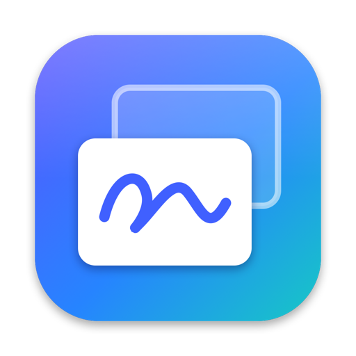

<p align="center"></p>

# TutorMirror

TutorMirror mirrors an iPad or iPhone to your Mac over AirPlay, with as little
lag as I could get out of it. I use it to teach online. I share the mirror
window on the call, and when I need to do something the student shouldn't
watch, I freeze it.

## What it does

- Mirrors with very little lag: it asks for 60 fps and sends each frame
  straight from the decoder to the screen ([details](#why-its-faster)).
- Freeze (F) holds the picture still while you flip to the answers, rotate
  or even disconnect the iPad.
- Blank (B) shows the student a "One moment…" screen instead.
- Draw on the picture from the Mac (D): pen, highlighter, arrow and box, in
  five colours.
- Zoom into part of the page with a pinch or ⌘-scroll.
- Crop the iPad's status bar or an app's toolbar off what the student sees.
- Save the board as a PNG (⌘S) or copy it to paste into the chat (⌘C).
- Hides your mouse pointer from the student while it's over the mirror. You
  still see it.
- Keeps the FROZEN label, the drawing toolbar and the lag meter on your
  screen only. Screen sharing leaves them out.
- Turns away other devices that try to take over mid-lesson. Your own iPad
  can always reconnect.
- Works with Goodnotes' presentation mode without cutting off the page.
- Keeps the Mac awake while you're mirroring.
- Updates itself from this page, and never in the middle of a lesson.
- Has a lag meter (⌘L) that shows where any delay comes from.

## Why I built it

I do all my writing on an iPad in Goodnotes and mirror it to my Mac so I can
share it on Meet. The app I was using worked, but my handwriting
showed up noticeably behind my pen, which gets annoying fast when you're
working through a problem live.

The other thing was privacy. Every time I flipped to the answer key or set up
the next question, the student watched me do it. I wanted a button that just
holds the picture still.

So I forked [VirtualMirror](https://github.com/souriscloud/VirtualMirror),
rewrote the video side to be faster, and added freeze. A few things came
along with it: a blank "One moment…" screen, drawing on the picture from the
Mac, zoom, cropping off the status bar, saving the board, hiding my mouse
pointer from the student, and a lag meter so I could see where the delay
comes from. The freeze and blank labels, the drawing toolbar and the lag
meter only show on my screen, because screen sharing leaves them out.

## Why it's faster

The AirPlay connection code is VirtualMirror's. I rewrote everything after
that, meaning how frames get decoded and drawn:

| | TutorMirror | VirtualMirror |
|---|---|---|
| Frame rate it asks the device for | 60 fps | 30 fps |
| Picture size it asks for | 2732×1536 (wide, so a 4:3 iPad still comes through at 2048×1536) | 1920×1080 (a 4:3 iPad comes through at 1440×1080) |
| Colour conversion | none, a Metal shader draws the raw YUV | converts every frame to BGRA |
| Route to the screen | straight from the decoder to Metal, and only the newest frame gets drawn | decoder, then main thread, then SwiftUI, then a display layer |
| Network packets | read where they land, decrypted straight into the decoder's buffer | copied several times per frame |

The frame rate makes the biggest difference: asking for 60 instead of 30
halves the time between frames, so writing looks a lot smoother.

On my setup (iPad Pro, MacBook Pro, 120 Hz monitor, 5 GHz
Wi-Fi), decoding a frame takes about 3 to 4 ms and getting it on screen takes
about 16 ms. The Wi-Fi round trip is around 11 ms, and on a worse network the
Wi-Fi will add more delay than everything else put together.

## What you need

- A Mac on macOS 14 (Sonoma) or newer. Apple Silicon and Intel both work.
- An iPad or iPhone on the same Wi-Fi.
- Optional: turn off the Mac's built-in receiver (System Settings → General →
  AirDrop & Handoff → AirPlay Receiver) so you don't pick the wrong one from the list.

## Install

### Download it

1. Grab `TutorMirror.zip` from the [latest release](../../releases/latest),
   unzip it and drag TutorMirror.app into Applications.
2. I can't be asked paying £79 a year to Apple, so run this command in
   Terminal instead:

   ```bash
   xattr -dr com.apple.quarantine /Applications/TutorMirror.app
   ```

   (Otherwise macOS will block it the first time you open it.)

   Or go to System Settings → Privacy & Security, scroll down and click
   Open Anyway.

3. When it asks to find devices on your local network, say Allow. If you
   don't, your iPad won't be able to see it.

The first time it opens you get a short welcome screen with the basics. It's
under Help → Welcome to TutorMirror if you want it again.

### Updates

From 0.2.0 on, TutorMirror checks this page for a new release when it opens,
and every few hours after that. If there is one, it asks, then downloads it,
swaps itself out and reopens. Your settings stay. It never asks while you're
mirroring: an update it finds mid-lesson waits until you've stopped. You can
also use TutorMirror → Check for Updates…, or turn the automatic check off in
the same menu.

If you have 0.1.x, download the latest version by hand once. Those versions
don't have the updater yet. After an update macOS may ask about local network access
again. Say Allow.

### Or build it

You'll need Xcode or its command line tools.

```bash
git clone https://github.com/t7acct/tutor-mirror.git
cd tutor-mirror
./build.sh --run
```

`./build.sh --install` builds it, copies it into Applications and opens it
from there. `./build.sh --release` makes a zip that runs on both Apple
Silicon and Intel.

`./build.sh --test --run` builds a separate "TutorMirror Test" app with its
own settings, ports and receiver name, so you can try changes while the real
one is mirroring a lesson. `./release.sh "notes"` publishes the version in
`Resources/Info.plist` as a GitHub release, which is what the updater looks
for.

## Using it

1. Open TutorMirror.
2. On the iPad or iPhone: Control Center → Screen Mirroring → TutorMirror.
3. On your call, share the TutorMirror window, not your whole screen.

Then click the TutorMirror window and use these keys:

| Key | Your student sees | You see |
|---|---|---|
| F | the picture stops (F again goes live) | a blue FROZEN label |
| B | a "One moment…" screen (B again to undo) | a purple BLANK label |
| D | your drawings | the drawing toolbar |
| X | the drawings disappear | |
| = and - | the picture zoomed in or out | a grey ZOOMED label |
| 0 | the whole page again | |
| ⌘S | nothing | the snapshot goes to Pictures › TutorMirror |
| ⌘C | nothing | the picture is copied, ready to paste |
| ⌘K | | the crop sliders |
| ⌘L | nothing | the lag meter |
| ⌃⌘F | the mirror, full screen | |

The single-letter keys only work while the TutorMirror window is in front, so
you can still type them in other apps. Freeze, Blank and Draw are also in the
View menu and in the menu bar icon.

Once it's frozen you can flip pages, rotate the iPad, lock it or even
disconnect it, and the student keeps seeing the still picture. The app keeps
decoding in the background while frozen, so going live again is instant.

If you share your whole screen instead of the window, the student can see your
menu bar, where the TutorMirror icon says FROZEN while it's frozen.

### Drawing

Press D and draw on the mirror with the mouse or trackpad. The toolbar along
the bottom (only you see it) has a pen, a highlighter, an arrow and a box,
plus colours. While drawing, P, H, A and R pick those tools, Delete undoes the
last mark, and D or Esc stops drawing. Drawings stay on screen until you press
X, so you can freeze, mark up the frozen page, then clear and go live.

### Zoom

Pinch on the trackpad, or hold ⌘ and scroll, to zoom in where the pointer is.
Drag or two-finger scroll to move around, and double-click or press 0 to see
the whole page. The student sees the zoomed picture.

### Crop

View → Crop cuts edges off what the student sees. Hide Status Bar takes off
the iPad clock and battery. Hide Status Bar and Toolbar also takes a note
app's toolbar off the top, but toolbars vary, so open Adjust Crop… (⌘K) and
nudge the sliders until it just disappears. The crop is remembered.

### Saving the board

⌘S saves what the student sees right now, drawings and crop included, as a
PNG in Pictures › TutorMirror. File → Show Snapshots Folder opens it. ⌘C
copies the same picture so you can paste it into the chat.

### Your mouse pointer

Meet, Zoom and Teams show your mouse pointer to the student whenever it's
over the window you're sharing. TutorMirror hides it while it's over the
mirror window and draws a stand-in in its place that only you can see. You
can still click, draw and drag the window without the student watching an
arrow wander across the page. This works while Meet or Zoom is the app in
front too.

If another app's window sits on top of the mirror, the pointer shows as
normal over that window. If you'd rather point at things with the mouse,
turn it off with View → Hide Pointer from Students.

## Settings

Rename the receiver (the name in your device's Screen Mirroring list) under
View → Rename Receiver…. iPad audio is off by default. Turn it on with View →
Play iPad Audio.

There are a few more settings in `defaults`. Reconnect your device after
changing them.

```bash
defaults write local.tutormirror maxFPS -int 120         # ask for 120 fps (most devices still send 60)
defaults write local.tutormirror streamWidth -int 3640   # ask for a bigger picture
defaults write local.tutormirror streamHeight -int 2048
defaults delete local.tutormirror                        # back to defaults
```

To look at the lag numbers after a session:

```bash
log show --last 10m --predicate 'subsystem == "local.tutormirror" AND category == "Lag"'
```

## What works and what doesn't

I've only tested it with my iPad Pro running Goodnotes. Other iPads and
iPhones speak the same protocol, so they should be fine, and the window
reshapes itself for portrait, landscape and phones. If something breaks on
your device, open an issue.

It handles one device at a time. While your iPad is mirroring, another
device that picks TutorMirror from its Screen Mirroring list is turned away
(it shows "unable to connect"), and only you see a short note saying who it
was. Your own iPad can always reconnect, after a lock, a rotation or a Wi-Fi
blip. Once your iPad stops mirroring, or has sent nothing for a few seconds,
another device can connect. To let any device take over at any time, turn on
View → Let Other Devices Take Over.

Goodnotes' presentation mode works too: the iPad keeps its toolbar and the
student only sees the page. TutorMirror tells the iPad it's a widescreen
display so Goodnotes doesn't cut off the sides of the page.

While you're mirroring, TutorMirror keeps the Mac and its display awake, so the
shared window doesn't freeze when you've only been writing on the iPad.

It only does screen mirroring. Casting a YouTube video, audio-only AirPlay
from Music and 4K/H.265 streams won't work.

If your device can't find TutorMirror, check they're on the same network,
check TutorMirror is allowed under System Settings → Privacy & Security →
Local Network, and try View → Restart Receiver.

## If the picture hitches about once a second

That's most likely AWDL, the thing macOS uses for AirDrop, Handoff and
Universal Clipboard. About once a second it takes the Mac's Wi-Fi off your
network for up to 100 ms. On my setup that adds around 22 ms to the average
frame, which is more than the whole Mac side of TutorMirror.

The lag meter (⌘L) shows it. The `delayed` line is how much longer each frame
took to arrive than the fastest recent one. The `hiccup` line is the longest
gap between frames, split into "iPad idle" (nothing changed on the iPad's
screen) and "held up" (the frame existed and got stuck on the way). With AWDL
you'll see a gap of about 100 ms, nearly all of it held up.

The app can't stop this, I tried. Turning AWDL off does, if you can live
without AirDrop and Handoff for a while:

```bash
sudo ifconfig awdl0 down   # "up" brings it back, and so does a restart
```

Plugging the Mac into Ethernet should get around it too, though I haven't
tried that. I leave AWDL on, because I use Universal Clipboard while teaching.

## Credits and licence

This is a modified version of
[VirtualMirror](https://github.com/souriscloud/VirtualMirror) by Souris.CLOUD
(forked from commit
[`4d69798`](https://github.com/souriscloud/VirtualMirror/commit/4d697984807c2cbf36b271ab71f53493e7019c68)),
which builds on
[UxPlay](https://github.com/FDH2/UxPlay), [RPiPlay](https://github.com/FD-/RPiPlay)
and [shairplay](https://github.com/juhovh/shairplay). See
`ACKNOWLEDGMENTS-VirtualMirror.md`. I rewrote the video code in `Sources/Video`
and wrote the app and tutoring features in `Sources/App`. The protocol code
is theirs, with small changes.

GPL-3.0, same as the projects it's built on (see `LICENSE`). Not affiliated
with Apple. AirPlay, iPad and iPhone are Apple trademarks.
